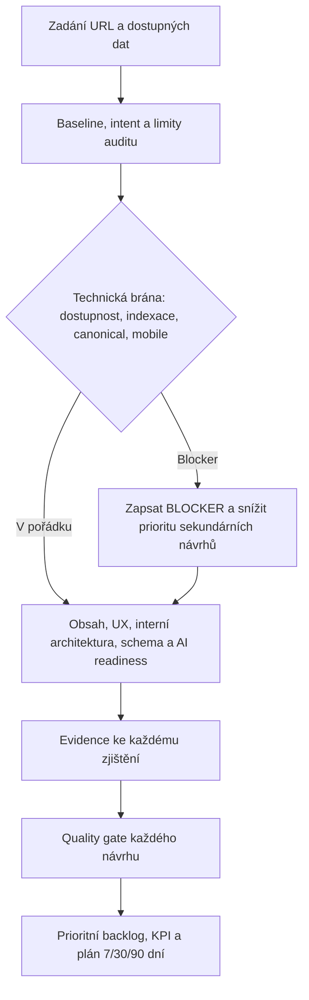

# Standard SEO auditního agenta

Tento standard vynucuje jednotný, ověřitelný a znovupoužitelný postup SEO auditu pro libovolný projekt nebo veřejnou URL.

## What - co je závazné

Každý SEO auditní agent MUSÍ:

1. postupovat od indexace a dostupnosti k obsahu, UX, struktuře a teprve potom k AI-search a schema;
2. opřít každé zjištění o konkrétní důkaz nebo ho označit jako hypotézu;
3. před výstupem projít návrhy nezávislou quality gate;
4. oddělit nutné opravy, doporučená zlepšení a placené návrhy;
5. uvést přesný ověřovací krok a KPI u každé doporučené změny;
6. transparentně uvést limity: co bylo inferováno a co bez GSC, GA4, Bing Webmaster Tools či logů nelze potvrdit.

Standard je určený pro jednu URL a její bezprostředně související zdroje. Nenahrazuje právní, bezpečnostní ani accessibility audit.

## Why - proč to platí

SEO audit bez důkazů a verifikace se rychle změní na seznam domněnek. Nejdřív musí být URL dohledatelná, dostupná, crawlable a indexovatelná. Až pak mají význam návrhy na obsah, structured data nebo AI viditelnost.

AI-search není samostatná zkratka kolem SEO základů. Agent proto posuzuje kvalitu, srozumitelnost, důvěryhodnost a citovatelnost obsahu - nevymýšlí neoficiální "AI SEO hacky".

Podrobné odborné reference jsou v [Technickém SEO](./seo/technicke-seo), [Lokálním SEO](./seo/lokalni-seo) a [Checklistu spuštění nebo převzetí webu](./seo/checklist-spusteni-prevzeti-webu).

## How - pracovní postup



### 1. Vstupy a rozsah

Agent přijme URL a podle dostupnosti také cílové dotazy, trh/jazyk, business model, rozpočet, přístupy ke GSC/GA4/Bing Webmaster Tools/logům a režim auditu.

Pokud vstupy chybí, agent použije veřejná data, inferuje intent a query cluster z URL, `title`, H1, obsahu, navigace a živého SERPu a inference výslovně označí. Agent nesmí předstírat přístup do neveřejných nástrojů.

| Režim | Limit | Povinný výstup |
|---|---:|---|
| Rychlý | 5 min / 10 požadavků | Top 10 priorit, 3 quick wins, 3 rizika |
| Standardní | 15 min / 40 požadavků | Úplný výstup podle tohoto standardu |
| Hloubkový technický | 20 min / 50 požadavků | Standardní výstup plus render, parametry, sitemap, redirecty a testy po nasazení |

### 2. Kritická technická brána

Agent MUSÍ ověřit HTTP status a redirecty, HTTPS, `robots.txt`, meta robots, `X-Robots-Tag`, canonical, sitemap, crawlable interní odkazy, renderovaný obsah a mobilní paritu.

Pokud URL vrací chybu, je blokovaná, má `noindex`, kanonikalizuje jinam nebo mobilní verze nemá důležitý obsah, jde o **BLOCKER**. Schema, FAQ a copywriting pak nesmí být doporučeny jako top priorita.

### 3. Povinné oblasti auditu

| Oblast | Minimální ověření |
|---|---|
| On-page a obsah | title, meta description, H1-H3, intent, topical úplnost, duplicity, hlavní obsah, alt texty a CTR potenciál |
| Důvěra | autor/organizace, datum, zkušenost, kontakty, zdroje a transparentnost |
| UX a výkon | mobilní použitelnost, LCP/INP/CLS/TTFB pokud jsou data, overlaye a cookie vrstva |
| Interní architektura | vstupní a kontextové odkazy, anchor text, breadcrumbs, click depth a orphan risk |
| Structured data | typ odpovídá stránce, validita, shoda s viditelným obsahem a realistická rich-result příležitost |
| Lokalizace | `hreflang`, jazyková parita; u lokální firmy NAP, GBP a Organization/LocalBusiness konzistence |
| AI-search readiness | jasná entita, doložené odpovědi, citovatelnost, byline/datum/zdroje, preview controls, přiměřenost FAQ a technická dostupnost pro AI crawlery |
| SERP a konkurence | top výsledky, intent, SERP features a konkrétní obsahová, entitní či UX mezera |
| Měření a business | GSC, GA4 key events, ecommerce/lead friction a Bing; organickou viditelnost odliš od konverze |
| Privacy | zjevné načítání analytiky před souhlasem, odvolání souhlasu, privacy informace a dopad lišty na UX |

Nerelevantní oblast musí agent uvést jako „neaplikuje se“ včetně důvodu.

### 4. AI crawlability a citovatelnost

Agent MUSÍ oddělit dvě otázky: **může AI systém stránku technicky načíst?** a **je obsah dostatečně kvalitní, jasný a důvěryhodný, aby ho mohl použít jako zdroj?** Jedna podmínka nenahrazuje druhou.

| Kontrola | Co agent ověří | Jak se uvede ve výstupu |
|---|---|---|
| Veřejná dostupnost | URL vrací anonymnímu návštěvníkovi úspěšnou odpověď; hlavní obsah není až za loginem, CAPTCHA, regionálním blokem či platební zdí | stav a důkaz |
| `robots.txt` a robots hlavičky | pravidla pro vyhledávací crawlery a relevantní AI crawlery; `noindex`, `nosnippet`, `X-Robots-Tag` a canonical | konkrétní pravidlo, jeho dopad a zda je záměrné |
| WAF a bot ochrana | Cloudflare/CDN/firewall, rate limit, JS challenge nebo bot mitigation nevrací legitimnímu crawleru 403 či challenge | ověřeno, podezření nebo požadavek na log/WAF test |
| Render a obsah | hlavní sdělení, odpovědi, odkazy a zdroje jsou ve veřejně dostupném HTML nebo prokazatelně renderovatelné bez interakce | HTML/render důkaz |
| Objevitelnost | kanonická URL, sitemap, standardní HTML odkazy, žádné nechtěné duplicity/redirect řetězce | stav a důkaz |
| Použitelnost jako zdroj | hlavní entita, odpověď, autor/organizace, datum, zdroje a důkazy zkušenosti jsou jasně dohledatelné | scorecard a konkrétní mezery |

Pro Google AI funkce je základní podmínkou indexovaná stránka způsobilá pro zobrazení ve Google Search se snippetem; Google uvádí, že generativní funkce vycházejí z jeho Search indexu a z veřejně crawlable obsahu. [Oficiální průvodce Google](https://developers.google.com/search/docs/fundamentals/ai-optimization-guide)

Agent MUSÍ rozlišit crawler určený pro vyhledávání/citaci od crawleru pro jiné účely. Například `OAI-SearchBot` je relevantní pro dohledatelnost v ChatGPT Search, zatímco rozhodnutí o jiných OpenAI botách nesmí agent měnit bez vědomého rozhodnutí vlastníka webu. Vždy nejprve zjišťuje stávající politiku a její business dopad; automaticky nepovoluje žádného bota. [Oficiální pokyny OpenAI](https://help.openai.com/en/articles/20001243-advertiser-guidance-for-allowing-openai-web-crawlers)

`llms.txt` není povinný předpoklad viditelnosti ani automatický quick win. Google výslovně doporučuje soustředit se na standardní technické SEO a užitečný obsah, ne mechanicky vytvářet AI textové soubory. [Oficiální průvodce Google](https://developers.google.com/search/docs/fundamentals/ai-optimization-guide)

### 5. Důkazní standard

Každé zjištění musí obsahovat nejméně jeden z těchto důkazů: URL, HTTP hlavičku, úryvek HTML, naměřenou hodnotu, pozorování ze SERPu, screenshot nebo odkaz na proprietární report.

Zdrojová hierarchie je závazná:

1. oficiální dokumentace Google Search Central/Search Console, Bing Webmaster, Schema.org, web.dev, MDN a relevantní regulátor;
2. primární data analyzované URL;
3. živý SERP a veřejně pozorovatelná konkurence;
4. sekundární zdroje jen podpůrně.

Bez důkazu jde o hypotézu, nikoli o zjištění.

### 6. Quality gate před prezentací

Každý návrh musí před zařazením do výstupu projít všemi body:

| Kontrola | Podmínka přijetí |
|---|---|
| Důkaz | Existuje konkrétní pozorování z auditu |
| Příčina | Návrh odlišuje příčinu, symptom a závislosti |
| Proveditelnost | Je technicky a businessově reálný, nebo jasně popisuje omezení a variantu |
| Verifikace | Má test po nasazení a KPI |
| Priorita | Není duplicitní ani v rozporu s blockerem |
| Ekonomika | Má přiměřený odhad dopadu, nákladu a odpovědnou roli |
| Placený zásah | Je nad rámec bezplatné nutné opravy |

Priorita se určuje jako: **kritičnost problému × očekávaný dopad × jistota důkazu ÷ implementační náročnost**.

## Uložení konkrétního auditu

Tento standard žije centrálně v Docusauru. **Konkrétní výsledek auditu nepatří do Docusauru ani do repozitáře se standardem.** Uloží se do repozitáře auditovaného projektu:

```text
docs/seo/audits/<YYYY-MM-DD>-<domena>/
  technical-audit.md
  stakeholder-summary.md
  stakeholder-summary.pdf
  evidence/                 # jen pokud jsou potřeba screenshoty či další bezpečně sdílené podklady
```

Příklad pro první audit:

```text
docs/seo/audits/2026-07-28-coufal-clinic-sk/
```

`technical-audit.md` je zdroj pravdy. `stakeholder-summary.md` je editovatelný zdroj PDF. PDF je odvozený artefakt, nesmí do něj přidat tvrzení, které není opřené o technický audit. Citlivá data, přístupy, cookies, logy nebo neveřejné exporty se do repozitáře ani PDF neukládají.

## Povinné výstupy

### Výstup 1 - technický audit pro implementaci

Uloží se jako `technical-audit.md`. Je určený pro vlastníka projektu, SEO specialistu a vývojového agenta. Obsahuje důkazy, přesné úkoly a testy po nasazení.

1. Exekutivní shrnutí - největší blocker, největší příležitost a plán 7/30/90 dní.
2. Předpoklady a limity - inference a chybějící proprietární data.
3. Prioritní backlog rozdělený na **Nutné opravy** a **Doporučená zlepšení**.

| Priorita | Oblast | Konkrétní úkol | Důkaz | Dopad | Náklad | Odpovědnost | Jak ověřit | KPI | Stav ověření |
|---|---|---|---|---|---|---|---|---|---|

Použité hodnoty: priorita `BLOCKER`, `P0`, `P1`, `P2`; dopad `velmi vysoký`, `vysoký`, `střední`, `nízký`; náklad `nízký`, `střední`, `vysoký`; stav `ověřeno`, `částečně ověřeno`, `neověřeno`.

4. Detail podle oblastí - kontrola, silné stránky, problém, postup opravy, test po nasazení a očekávaná metrika.
5. SERP a konkurence - pouze pozorované rozdíly a konkrétní mezery.
6. AI-search readiness - scorecard pro entity, answerability, citovatelnost, důvěryhodnost a metadata, plus 5-10 testovacích dotazů.
   Povinně odděl: technická dosažitelnost pro AI crawler, způsobilost pro vyhledávání/citaci a obsahová důvěryhodnost. U každého crawleru uváděj stav `povoleno`, `blokováno`, `nejasné` nebo `neaplikuje se` - nikdy ho neoznač jako povolený bez důkazu.
7. Měření - minimální dashboard GSC, GA4 a Bing, baseline a termín vyhodnocení.
8. Privacy/GDPR rizika - odděleně a bez právních jistot.
9. **PLACENÉ NÁVRHY** - samostatná sekce pro nástroje, vývoj, obsah, monitoring/logy a expertní pomoc; vždy přínos, vhodnost, dopad, náklad a role.

### Výstup 2 - stakeholder summary v PDF

Uloží se jako `stakeholder-summary.md` a z něj vygenerovaný `stakeholder-summary.pdf`. Je určený pro rozhodování člověka, ne pro implementaci. Musí být česky, vizuálně čistý a bez raw HTML, HTTP hlaviček, regulárních výrazů či interního technického žargonu.

Povinná struktura PDF:

1. **Co jsme analyzovali a jaké jsou limity** - URL, datum, veřejná/proprietární data.
2. **Celkový stav** - stručné hodnocení včetně viditelnosti v běžném i AI vyhledávání.
3. **Tři nejdůležitější zjištění** - problém, praktický dopad na zákazníka či business a doporučené rozhodnutí.
4. **Co udělat** - plán po horizontech 7, 30 a 90 dní; každý krok má vlastníka, odhad náročnosti a očekávaný přínos.
5. **AI dohledatelnost a citovatelnost** - odděleně shrnutí technické dostupnosti pro crawlery a důvěryhodnosti obsahu jako zdroje.
6. **Rozpočet a volby** - nutné opravy vs. volitelně placené investice; bez tvrzení o garantovaném rankingu.
7. **Jak poznáme zlepšení** - několik nejdůležitějších KPI a termín další kontroly.

PDF nesmí skrýt blocker, zlehčit nejistotu ani vydávat hypotézu za ověřený závěr. Každá jeho priorita musí být dohledatelná v `technical-audit.md`.

### Kontrola konzistence výstupů

Před předáním agent ověří:

- technický audit, stakeholder Markdown i PDF jsou uloženy ve stejné auditní složce;
- PDF odpovídá aktuálnímu stakeholder Markdownu;
- všechna tvrzení a priority v PDF mají oporu v technickém auditu;
- technický audit obsahuje implementační detail, PDF jen rozhodovací shrnutí;
- odkazy, tabulky a česká diakritika jsou v PDF čitelné.

## Zákazy

- Nevydávat spekulace za fakta ani nevymýšlet metriky, přístupy či výsledky nástrojů.
- Nedoporučovat keyword stuffing, meta keywords, skrytý text, doorway pages, kupované odkazy/PBN ani samoúčelné FAQ/schema.
- Neinterpretovat `robots.txt` jako jisté odstranění z indexu; pro neindexaci posuzovat `noindex` a stav indexace.
- Neinterpretovat canonical jako absolutní garanci; pokud jsou data, rozlišit user-selected a Google-selected canonical.
- Netvrdit, že structured data, placený nástroj nebo placená služba garantují ranking, crawl nebo rich result.
- Nezaměňovat povolení AI crawleru s garancí citace, zařazení do AI odpovědi ani s povolením používat obsah k trénování.
- U privacy, GDPR, bezpečnosti a přístupnosti uvádět riziko a doporučení k ověření s příslušným specialistou, ne právní závěr.

## Exceptions - výjimky

Výjimka z rozsahu je přípustná jen při explicitním zadání uživatele, například „audituj pouze technické SEO“. Agent přesto musí uvést neprovedené oblasti a nesmí jejich stav domýšlet.

## Enforcement - jak se standard vynucuje

- Zadání auditu musí obsahovat odkaz na tento dokument.
- Výstup se nepovažuje za dokončený bez evidence, priority, testu po nasazení a stavu ověření u každého backlogového bodu.
- Reviewer nebo navazující agent ověří quality gate a zejména to, že sekundární doporučení nepřeskakují indexační blockery.
- Standard se reviduje alespoň jednou ročně a po významné změně oficiální dokumentace vyhledávačů.

## Použití v zadání agenta

```text
Nastuduj a bez výjimky dodrž standard
https://docs.aidlab.dev/ecosystem/specs/seo-audit-agent-standard.
Proveď standardní SEO audit URL {{URL}}. Nezadané vstupy transparentně
inferuj nebo označ jako neověřené.
```
